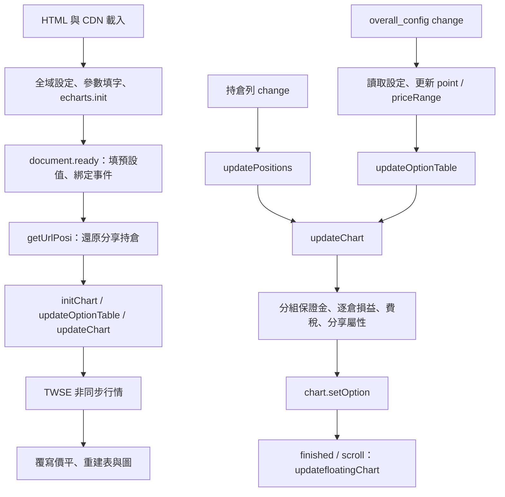

# 實作架構書：AI 維護上下文

## 1. 文件契約與查核範圍

此文件以 **2026-10-13 工作目錄中的實際程式**為準，包含本次尚未提交的參數更新與閃電表寬度功能。這是現況描述，不是未來設計，也不是金融規則正確性的認證。程式與本文衝突時，先讀實作確認，再修正文書；不要將已知缺陷視為必須保留的業務需求。

供 AI 使用的閱讀順序：本文件 → `index.html` 的相關 DOM → `script.js` 的具名函式／事件 → `style.css`。以下以可搜尋的符號定位，避免行號因改動失效。使用者操作文件另見 `README.md`。

## 2. 系統邊界與檔案責任

單頁計算工具加一個獨立隱私頁；所有本專案計算都在瀏覽器執行。沒有後端、資料庫、登入、券商下單 API、套件管理清單、打包器、測試套件、CI 或部署 workflow。不得假設存在 React、npm scripts、伺服器端環境變數或雲端持倉同步。

| 檔案 | 實際責任與注意事項 |
| --- | --- |
| `index.html` | DOM 骨架、說明文章、`#calc_para` 參數顯示、CDN script、SEO／分享 meta、GTM、ShareThis、廣告版位、贊助連結 |
| `script.js` | 傳統全域 script，集中所有狀態、事件、計算、序列化與 ECharts 操作 |
| `style.css` | 深色樣式、三欄主畫面、浮動圖、遮罩、持倉表、直向版型 |
| `privacy-policy.html` | 靜態隱私文字，共用 CSS；文字描述不等於已實作資料收集流程 |
| `manifest.json` | standalone 與圖示設定；`index.html` 沒有 manifest link，沒有 service worker 或離線快取 |
| `Share.png`、`favicon*.png`、`ecpay.svg` | 公開靜態素材，應納入版本控制 |
| `robots.txt` | 允許所有爬蟲存取 |
| `ads.txt` | 公開廣告銷售授權資料，非私密金鑰 |

主頁 canonical 與分享圖指向 `https://ray8822881199.github.io/`。檔名與網址符合 GitHub Pages 使用情境，但無法由程式得知遠端 Pages 設定或是否已部署最新工作目錄。

## 3. 執行期相依與外部邊界

`index.html` 底部依序載入 pako **2.0.4**、jQuery **3.6.0**、jQuery UI **1.13.2**、jqueryui-touch-punch **0.2.3**、ECharts（jsDelivr URL **未固定版本**）、`script.js`。jQuery UI CSS 與 Material Icons 另在 head 載入。不可任意交換順序；`script.js` 在 ready 前就呼叫 `$` 和 `echarts.init`。

| 外部資源 | 程式用途 | 邊界 |
| --- | --- | --- |
| TWSE `rwd/zh/afterTrading/MI_INDEX` | `getLastTradingDate` 取得前一交易日資料 | 直接跨來源 fetch；依賴網路、CORS、回傳欄位 |
| TAIFEX `cht/5/indexMarging` | 參數來源超連結及人工查核 | 執行期不抓取保證金 |
| ShareThis | 社群按鈕與動態 `data-url` 等屬性 | 壓縮持倉 URL 交給第三方分享介面 |
| Google Tag Manager | head script／body noscript | 實際容器內容不在儲存庫，不推斷啟用的追蹤標籤 |
| AdSense 相關 meta、`ins`、queue | 廣告版位宣告 | 原始 HTML 未直接載入 AdSense loader；不保證廣告實際呈現 |
| 綠界贊助連結 | 跳轉外部支付頁 | 沒有本地支付處理或 webhook |

自有程式沒有 localStorage、sessionStorage、IndexedDB 或 cookie 持倉保存。不能據此宣稱整個網站不追蹤或不傳資料，因為存在第三方 script。分享 URL 的 gzip／Base64 只是編碼壓縮，不是加密。

## 4. 狀態與 DOM 契約

`window` 放置可跨函式讀寫的設定與函式；頂層 `let/const` 另存 `point`、`priceRange`、chart、拖拉狀態與浮動圖快取。不是模組架構，DOM 和 JS 狀態雙向耦合。

| 狀態 | 預設／來源 | 消費者 |
| --- | --- | --- |
| `positions` | `[]`，由持倉表更新 | 保證金、損益、CSV、分享 |
| `underlyingPrice` | 19500；可被行情或手動設定取代 | 價平、圖表範圍、閃電表 |
| `analysisWidth` | 6；UI 1–10，百分比 | `priceRange = underlyingPrice × (1 ± analysisWidth/100)` |
| `part` | 100；UI 50–200 | 圖表分段數，迴圈包含兩端 |
| `items` | 20 | 閃電表上下各 20 檔 |
| `point` | 50；允許 50/100/150/200 | 履約價間距，不是像素寬度 |
| `contractMultiplier` | 50 元／點 | 選擇權、小台；微台在算式除以 5 |
| `opFee`、`miniFee` | 各 25 元／口／單邊 | 微台共用 `miniFee` |
| `opTaxRate`、`miniTaxRate` | 0.001、0.00002 | 費稅試算 |
| `isdrawtest`、`iscalctest`、`isshowfloatchart` | 均 true | 測試部位啟用、測試費稅、浮動圖 |
| `marginInfo`、`dataDate` | 程式固定值 | 計算與 `#calc_para` 顯示 |

目前固定保證金（元）：

| 類別 | 小台 | 微台 | A | B | C |
| --- | ---: | ---: | ---: | ---: | ---: |
| `od` 原始 | 175250 | 35050 | 187000 | 94000 | 18800 |
| `mm` 維持 | 134500 | 26900 | 143000 | 72000 | 14400 |

`dataDate` 為 2026-08-12 來源更新日期；2026-10-13 查核日期另外寫在 JS 註解與 HTML。不是程式當下的系統日期，也沒有自動更新排程。

重要 DOM：`#optionTable` 閃電表、`#positions tbody` 持倉列、`#chart` ECharts、`#floating-chart` 圖片、`.overall_config` 設定事件、`#lightning-width` 新增間距、`#partialCloseDialog` 平倉對話框、`#overlay` 手機遮罩。`#comfirmPosition` 是現存拼字，改名須同步 JS 和 HTML。

### 持倉資料模型

`updatePositions(row)` 從 DOM 讀取下列欄位，以 `positionId` 查找後 Object.assign，或 push 新物件：

| 欄位 | 型別／意義 |
| --- | --- |
| `positionId` | number，本頁 DOM 中最大 ID + 1；匯入時重新建立，非永久識別碼 |
| `type` | `long_mini`、`short_mini`、`long_micro`、`short_micro`、`buy_call`、`sell_call`、`buy_put`、`sell_put`；未選可能為 null |
| `strikePrice` | number，選擇權履約價／期貨進場點位 |
| `cost` | number，權利金點數；期貨欄位 readonly |
| `quantity` | number，口數；DOM 讀值用 parseFloat，未全面驗證正整數 |
| `istest` | boolean，測試單 |
| `isactive` | boolean，是否計算 |
| `isclosed` | boolean，已平倉 |
| `closeAmount` | number，選擇權平倉權利金／期貨出場點位 |
| `groupId` | string，組合碼；空字串表示獨立部位 |

沒有到期日、契約月份、交易時間或即時報價欄位；不能推斷同組部位已驗證相同到期日。

## 5. 初始化與更新流



- ready 先呼叫 `getUrlPosi`；若分享資料解析拋錯，後面的初始化與行情請求可能不執行。
- 行情從昨天開始往回查，最多 10 個日曆日；接受 `stat === 'OK'` 且 `tables[0].data` 非空，再找「發行量加權股價指數」。`formatDate` 用 UTC ISO 日期。
- 成功回應會覆寫價平，即使使用者在等待時已手動輸入。無 loading lock、取消或防競態機制。
- `.overall_config` 的 change 會讀取全部設定並更新表／圖；非法閃電表間距回退 50。此設定不保存或包含在分享中。
- `updateOptionTable` 以 `Math.round(underlyingPrice / point) * point` 為中心，迴圈產生 41 個履約價，中心列上色。切換間距不修改 `positions`。

## 6. 操作與持倉生命週期

`addItem` 建 DOM、綁定按鈕、prepend 列、填值，最後觸發選單 change 才同步 `positions`。UI 新列位於前面，陣列新增位於尾端，兩者順序不相同。新增預設測試且啟用；`istest` 優先於 `isclosed`，測試單新增時會強制未平倉。

- 閃電表委派 mousedown/touchstart，document 處理 move/end。終點以起點欄位的 X 位置尋找，因此拖拉建立同類 Call 或 Put 價差，不是跨欄配對。
- 左鍵／觸控同點買進，跨價買起點、賣終點；其他滑鼠鍵同點走賣出分支。介面說明主打右鍵賣出；contextmenu 被取消。
- 組合碼由方向、Call/Put、現有組合碼中的最大數字 + 1 組成。
- 測試納入計算開關的 click 實際修改所有測試列 `isactive`，不是只隱藏曲線；測試費稅開關不直接控制損益或保證金。
- 「測試倉套用」清除所有測試勾選。「清空倉位」逐一觸發移除，每次都會更新圖表。
- 部分平倉：剩餘量大於平倉量時，減少原列，新增無組合碼、非測試、啟用、已平倉列；全數平倉則修改原列並取消測試。數量不足 alert。
- `finishBuild` 關遮罩、恢復 body 捲動；直向時隱藏閃電表。

## 7. 計算路徑與單位

### 7.1 分組與保證金

`groupPositionsByGroupId` 排除已平倉與未啟用列，非空組合碼放同組，無組合碼各自一組。`calculateComboMarginAndPremium` 接受一或兩個 ID，其他長度拋錯；查無 ID 也拋錯。

單腿：買選擇權保證金為零；賣方走 `calculateOptionMargin`；小台／微台讀固定保證金，再乘口數。回傳 `margin` 為元；`premiumReceived`、`premiumPaid` 是權利金點數 × 口數，`updateChart` 只使用回傳的 margin。

賣方算式，令 S 為模擬指數、K 為履約價、P 為建倉成本、M=50：

```text
distance = abs(S - K)
倍數 = distance < 500 ? 1 : distance < 1000 ? 1.2 : 1.5
OTM(call) = max((K - S) * M, 0)
OTM(put)  = max((S - K) * M, 0)
margin = P * M + max(A * 倍數 - OTM, B * 倍數)
```

注意：實作以絕對距離調整 A/B，價內也加收；權利金用輸入 cost，不是模擬點位的市價。此處忠實記錄程式，不主張等同主管機關規則。

兩腿白名單僅三種：

| 組合 | 實作 |
| --- | --- |
| sell_call + sell_put | 要求 Call K ≥ Put K；`(max(兩腿單口保證金) + 較低保證金腿的 cost*50 + C) * Call口數` |
| buy_call + sell_call | 買 K > 賣 K 時 `(買K-賣K)*買口數*50`，否則 0 |
| buy_put + sell_put | 買 K > 賣 K 時 0，否則 `(賣K-買K)*賣口數*50` |

不支援買跨式、兩腿期貨或期貨選擇權混合組合的分組計算。未檢查兩腿口數相同，不拆剩餘口數。`updateChart` 對每組拋錯直接 catch/continue，並未退回逐腿計算或告知 UI。

### 7.2 損益與費稅

`updateChart` 對啟用且基本欄位存在的部位逐倉運算。內部先用等值點數，最後乘 50 成元；微台先除 5，因此每點等值 10 元。未平倉 Call 使用 max(S-K,0)、Put 使用 max(K-S,0) 的到期內含價值，再減／加建倉成本；期貨是方向性價差。已平倉損益固定為進出價差，與模擬 S 無關。

費用依啟用部位、`!istest || iscalctest` 判斷：未平倉只算進場一次，已平倉算進出兩次。每腿單口稅額先 `Math.round` 再乘口數：選擇權是權利金×50×0.001；小台是指數×50×0.00002；微台是指數×10×0.00002。沒有額外的到期履約稅路徑。

「持倉」「測試倉」「套用後」分別累加非測試、測試、全部啟用部位，但三條曲線都扣同一筆全部符合條件的 `feeAndTax`。獲利率為套用後淨損益／原始保證金，分母為 0 時輸出 0。

### 7.3 圖表與浮動圖

ECharts 六個 series 固定順序：持倉、套用後、測試倉、原始、維持、獲利率。`visualMap.seriesIndex = 5` 綁定獲利率；修改順序要同步。上下兩個 grid、三組 x/y axis，損益在上、保證金與獲利率在下。窄直向比例隱藏 legend。

浮動圖是 `chart.getDataURL()` 的快照，不是第二個互動 chart；原圖完全捲出頂端才顯示。以 `lastChartImage`、`chartRectChanged` 快取，jQuery UI draggable 支援拖曳。未註冊 chart.resize 或 ResizeObserver。

## 8. 持倉交換格式

### CSV

匯出 `positions.csv`，標頭取第一筆物件 Object.keys；各值包雙引號，Blob + object URL + download anchor，下載前 confirm。匯入 FileReader UTF-8 → 以換行和逗號 split → 去所有引號 → true/false/數字轉型 → `processImportedJSON`。

僅檢查 type、strikePrice、quantity 非 undefined；不驗證完整 schema。逐筆 `addItem` 加入現有持倉，忽略原 positionId，沒有整批 rollback。支援的是簡易 CSV，不是完整引號／逗號／換行轉義規格；數字形式 groupId 也可能被轉成 number。

### 分享 URL：既有相容性契約

`getShareUrl`：每筆持倉 → `{b: base36位元串, t: 組合碼}` → JSON（移除所有空白）→ pako.gzip → Base64 → encodeURIComponent → `origin + pathname + ?data=...`。

高位到低位的封裝順序（解碼反向）：

| 欄位 | 位元 | 編碼 |
| --- | ---: | --- |
| type | 3 | 0 long_mini、1 short_mini、2 buy_call、3 sell_call、4 buy_put、5 sell_put、6 long_micro、7 short_micro |
| istest / isactive / isclosed | 各 1 | boolean → 0/1 |
| strikePrice | 16 | 整數 |
| quantity | 10 | 整數 |
| cost | 16 | floor(cost × 10) |
| closeAmount | 16 | floor(closeAmount × 10) |

總共 64 bits，使用 BigInt，base36 轉回十進位逐字累積，不能改成一般 Number。可表示的無號範圍：履約價 0–65535、口數 0–1023、成本與平倉點數 0–6553.5。程式未主動驗證溢位或負值；尤其期貨平倉指數乘 10 後可能超過 16 bits。

組合碼先替換 Bull/Bear Put/Call Spread 為 bup/bep/buc/bec；解碼再替換回文字。JSON 的全域去空白也會改變一般自訂組合碼。此格式無版本欄位、無校驗碼，不含 positionId、價平、費率或畫面設定。

`getUrlPosi` 用 URLSearchParams 取 data，另做 decodeURIComponent、atob、ungzip、JSON.parse、位元解碼，再匯入；成功後 history.replaceState 清除整個 query/hash。`setShareInfo` 將 URL／標題寫到 ShareThis 屬性，產生失敗則退回無資料首頁連結；URL 還原沒有對等的錯誤捕捉。

## 9. 已知限制與錯誤處理落差

以下為程式檢視可確認的現況，本次文件工作沒有修正它們：

1. `updateChart` 配置 `new Array(part).fill(0)`，但迴圈跑 `i <= part`。索引 part 的累加起始值是 undefined，可能產生 NaN；保證金與損益取樣也分別使用未四捨五入／四捨五入的 S。
2. 組合拋錯被靜默略過；不支援或超過兩腿的組合可能低估保證金。兩腿口數不等未驗證。以上與 HTML 說明不能混為一談。
3. A/B 加收用絕對距離；500 含邊界加 20%、1000 含邊界加 50%，和頁面「價外／超過」文字不完全一致。
4. 損益三條曲線扣同一組費稅，未各自分攤；零口數在局部 `quantity || 1` 會變成一口。輸入缺少全面數值驗證。
5. 行情 async IIFE 無 catch；網路／JSON／找不到日期會拒絕。找不到指數列時會先在 null 呼叫 replace；NaN 也不受 `??` 回退保護。
6. 分享資料位元溢位、非整數與非法內容未完整防護；無版本與還原容錯。CSV 轉義不完整、匯入是逐筆追加，失敗可能已加入部分資料。
7. 關閉浮動圖旗標後 `updatefloatingChart` 直接 return，已顯示的圖未明確隱藏。
8. `updateOptionTable` row 模板含巢狀／多餘 `<tr>`，瀏覽器依 HTML 修復規則處理；不要把 DOM 列數直接當成履約價筆數。
9. CSS 手機分界是 `max-aspect-ratio: 1/1`，`finishBuild` 則看 orientation:portrait，判斷條件不完全相同；沒有完整 PWA／離線支援。
10. `opTaxRate`、`miniTaxRate` 與保證金皆固定；HTML 的教學、政策文字不代表程式已落實所有描述。沒有期貨跨商品抵減、SPAN、即時權利金或到期日風險模型。

## 10. AI 修改導航與驗證要求

| 需求 | 必須一起查看 |
| --- | --- |
| 參數更新 | JS 頂端 marginInfo/dataDate、HTML #calc_para 與來源日期；核對官方資料，不只改畫面文字 |
| 閃電表 | #lightning-width、point、overall_config、updateOptionTable、滑鼠／觸控委派 |
| 新商品 | positionOptions、兩份 typeMap、jsonDataLength、addItem/updatePositions、損益、費稅、保證金、CSV 與分享相容性 |
| 新組合 | groupPositionsByGroupId、calculateComboMarginAndPremium、錯誤處理、兩腿口數與殘餘部位 |
| 持倉欄位 | DOM、updatePositions、addItem、partialClose、CSV、位元格式及歷史連結 |
| 圖表 | updateChart 的資料與 axis/series 索引、tooltip、visualMap、浮動圖快取 |
| 版面 | style.css 比例斷點、JS 動態 inline styles、dialog 與 overlay |

保留此次範圍外的工作目錄修改。避免因整理文件順便改公式；若要修正上述限制，另用明確案例驗證實際影響。新增永久測試時再選擇工具，不能宣稱已有測試框架。

最低靜態檢查：`node --check script.js`（需 Node）、`git -c core.whitespace=cr-at-eol diff --check`（既有檔案採 CRLF）。它們不是功能或金融正確性測試。

建議依修改範圍執行以下案例，紀錄實際結果，不將清單視為已通過：

- 空持倉、新增／移除／修改八種 type；圖表兩端是否有限數值。
- 四個閃電表間距各檢查 41 個履約價、相鄰差值、中心價、持倉不變；桌面買賣與直向觸控拖拉。
- 裸賣距離 499/500/999/1000 點、Call/Put 價內外；原始與維持分別核算。
- 三種合法兩腿、非法組合、三腿、兩腿口數不等、已平倉／未啟用排除。
- 未平倉與已平倉損益、小台／微台倍率、測試納入與測試費稅、部分與全數平倉。
- CSV 來回與追加；分享八種 type、布林值、一位小數、組合碼、邊界／溢位、舊連結與損壞 URL。
- 行情正常、無資料、網路拒絕；外部 CDN 失敗與調整視窗大小。

## 11. 版本控制邊界

`.gitignore` 排除本機 secrets／環境檔、預設持倉匯出 `positions.csv`、`private-data/`、依賴環境、暫存、測試產物、日誌、個人 IDE／Codex 狀態及 OS 雜項。其他私人 CSV 請放 `private-data/`，不全域忽略 CSV、JSON、PNG、SVG、Markdown，避免掩蓋未來的合法測試資料與網站素材。

`.env.example` 與 `.env.*.example` 可提交，但只能放非秘密範例。`.gitignore` 不會取消已追蹤檔案，也不能當秘密掃描或資料去識別化工具。文件、未來共享指令、來源碼與公開素材仍應追蹤；不需要為此靜態專案自行創建 build/dist 流程。
